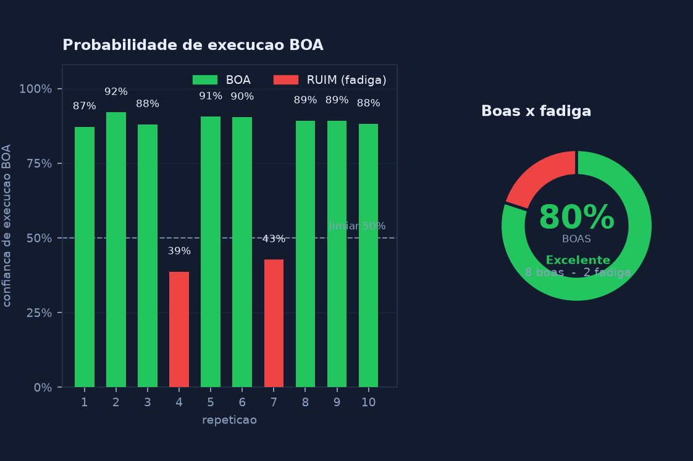

# Smart Gym — IoB (CP6)

**Classificação de execução em tempo real com Machine Learning**

O projeto deixa de ser apenas um **contador de repetições** e passa a ser um **avaliador de execução**: a cada repetição de rosca direita, um modelo treinado com dados reais classifica o movimento como **BOA** ou **RUIM (fadiga)**. A sessão inteira gera um **Score de Eficiência** exibido no dashboard, gravado no SQLite e publicado via MQTT.

> Documentação técnica detalhada do modelo: **[ML.md](ML.md)**

## Nome do grupo<br>
**Back-yardigans**

## Integrantes<br>
Gabriel Luni Nakashima RM558096 <br>
Milena Garcia Costa RM555111<br>
Gustavo Henrique RM556712<br>
Renan Simões Gonçalves RM555584<br>
Vinícius Vilas Boas RM557843<br>

---

## O que mudou em relação ao CP5

| CP5 | CP6 (IoB) |
|---|---|
| Contava repetições | Conta **e classifica** cada repetição |
| Métrica única: quantidade | Métrica principal: **Score de Eficiência** (% de repetições boas) |
| Sem aprendizado | **Random Forest** treinado com 10 repetições boas + 10 com fadiga |
| Painel só com Tkinter | **Dashboard** com gráfico por repetição + faixa de risco |
| MQTT só com contagem | MQTT com `classificacao`, `probabilidade_boa` e `score_eficiencia` |
| Banco com 2 tabelas | + `treinos` e `repeticoes` (histórico auditável com as features) |

Todo o comportamento anterior (RFID, validação no SQLite, garrafa obrigatória, HUD na câmera, fallback de digitação manual do ID) foi **preservado**.

## Funcionalidades<br>

### Classificação de execução com Machine Learning (novo)
Cada repetição concluída é convertida em **15 features** (amplitude, duração, velocidade, regularidade, inclinação do tronco, deriva do cotovelo, cadência, etc.). Um pipeline `StandardScaler + RandomForestClassifier` treinado no próprio projeto responde `BOA` ou `RUIM` com a probabilidade associada, em tempo real. As features são normalizadas pela largura dos ombros, então a distância da câmera não altera o resultado.

### Score de Eficiência (novo)
`Score = (repetições boas / repetições válidas) × 100`. O dashboard mostra o score parcial durante o treino (no HUD da câmera) e o consolidado no final, com faixa de risco:

| Score | Faixa |
|---|---|
| ≥ 80% | **Excelente** |
| 60% – 79,9% | **Atenção** |
| < 60% | **Risco de fadiga** |

### Dashboard do treino (novo)
Painel Tkinter com `matplotlib` embutido (`dashboard.py`):

- cartão com o Score de Eficiência, boas, ruins, duração e modelo utilizado;
- gráfico de barras por repetição (verde = BOA, vermelho = RUIM) com a linha do score;
- gráfico de rosca com a proporção boas × ruins;
- botões **Salvar gráfico (PNG)** e **Fechar**;
- abre automaticamente ao fim de cada sessão.



*Dashboard gerado por `python index.py --demo --png resultado_treino_demo.png` (sem câmera).*

### Leitura de Cartão RFID e Registro Automático<br>
O ID do cartão RFID lido pela Placa Arduino/ESP32 é validado diretamente em um banco de dados SQLite. O sistema realiza o registro automático do horário de acesso assim que o cartão é autorizado.

### Visão Computacional (Contagem de Repetições)<br>
Utilização de landmarks espalhados pelo corpo junto com a verificação do **ângulo do cotovelo** (ombro → cotovelo → pulso) para a contagem de repetições (MediaPipe). Ajuda o aluno a verificar se o exercício está sendo realizado de forma correta e com uma boa postura.

### Detecção de Objetos<br>
Utilização do YOLOv8 (Ultralytics) para detectar a garrafa de água. A repetição **só é contabilizada** se a garrafa estiver visível durante o movimento, garantindo a execução completa do exercício.

### Painel Visual Interativo<br>
Interface gráfica construída em Tkinter que gerencia o fluxo de uso da estação. Apresenta o status de "Aproxime seu cartão" no momento inicial e transita para "Treino Ativo" após a leitura do cartão, exibindo uma mensagem de boas-vindas ao aluno e um contador de exercícios na tela. O painel também mostra qual modelo está ativo (`Random Forest - LOO xx%` ou `Heuristico`).

### Publicação dos Dados via MQTT<br>
A cada repetição contabilizada, o sistema publica um JSON no servidor MQTT, permitindo montar dashboards em tempo real (Google Colab, Node-RED, Grafana, etc.). Ao final da sessão, publica o evento `fim_treino` com o Score de Eficiência.

---

## Como funciona o Machine Learning

```
Webcam ──> MediaPipe Pose ──> ângulo do cotovelo por quadro
                                    │
                                    ▼
                        RastreadorRosca (features.py)
              fecha a repetição quando o cotovelo volta a esticar (> 160°)
                                    │
                                    ▼
                        extrair_features() → 15 números
                                    │
                                    ▼
             ClassificadorRepeticoes (classifier.py + scikit-learn)
                     modelo_repeticao.joblib  (ou fallback)
                                    │
                    ┌───────────────┼────────────────┐
                    ▼               ▼                ▼
              SQLite (db.py)    MQTT (mqtt_client)  Dashboard (dashboard.py)
```

### As 15 features

| Feature | O que mede | Na fadiga |
|---|---|---|
| `angulo_min` | menor ângulo do cotovelo | aumenta (flexão incompleta) |
| `angulo_max` | maior ângulo (extensão) | pode diminuir |
| `amplitude` | excursão total do movimento | **diminui** |
| `duracao_s` | tempo da repetição | aumenta |
| `duracao_concentrica_s` | tempo até o pico de flexão | aumenta |
| `vel_media` | velocidade angular média | cai |
| `vel_max` | pico de velocidade | cai / errático |
| `vel_std` | irregularidade da velocidade | **aumenta** |
| `tempo_no_pico_s` | tempo parado na contração | aumenta |
| `inclinacao_tronco_media` | inclinação média do tronco | aumenta |
| `inclinacao_tronco_std` | balanço do tronco | **aumenta** |
| `abducao_ombro_media` | abertura do ombro | aumenta |
| `deriva_cotovelo` | deslocamento do cotovelo | **aumenta** |
| `confianca_media` | qualidade da detecção de pose | cai |
| `intervalo_anterior_s` | intervalo desde a repetição anterior | aumenta |

### Modelos e validação

`train_model.py` compara dois candidatos dentro de um `Pipeline` com `StandardScaler`:

1. **Random Forest** — `n_estimators=300`, `max_depth=4`, `class_weight="balanced"`. Robusto a escalas diferentes e a outliers, funciona com poucas amostras e fornece a importância das features.
2. **Regressão Logística** — `class_weight="balanced"`, `max_iter=2000`. Contraponto linear interpretável.

Validação com **Leave-One-Out** (treina N vezes deixando uma amostra de fora) + **StratifiedKFold(5)** para checar estabilidade. O melhor modelo pela acurácia LOO é reajustado com todos os dados e salvo.

### Repetição válida

- A repetição **começa** quando o ângulo cai abaixo de **60°** estando estendido.
- A repetição **fecha** quando o ângulo volta acima de **160°**.
- Contar só na volta à extensão garante que as features representem o ciclo inteiro.
- A garrafa precisa ter sido vista durante a repetição; caso contrário a repetição é **descartada** e não entra no score.
- Repetições com menos de 5 quadros ou amplitude < 20° são tratadas como ruído.

### Fallback heurístico

Se `modelo_repeticao.joblib` não existir (antes da coleta), o sistema **não quebra**: usa uma regra de bolso com as mesmas features e informa `Heuristico (modelo ainda nao treinado)` no painel e no banco. Assim a demonstração nunca fica sem resposta e fica explícito qual caminho está em uso.

> Detalhes completos, incluindo como produzir uma repetição "com fadiga" convincente, estão em **[ML.md](ML.md)**.

---

## Arquitetura do Sistema<br>
O sistema está estruturado em três camadas principais que se comunicam entre si:

### Hardware (Captura) <br>
O leitor RFID conectado à Placa Arduino/ESP32 lê as credenciais do usuário e envia o UID via comunicação Serial (USB) para o computador. Simultaneamente, a webcam captura o feed de vídeo.

### Backend (Processamento e Persistência)<br>
O `index.py` recebe os dados Seriais, conecta-se ao banco de dados local para checar a validade do cartão, registrar o horário e obter o perfil do aluno (nome, exercício e meta de repetições). Em paralelo, utiliza o framework MediaPipe e OpenCV para processamento de imagem, detecção de pose e cálculos matemáticos dos ângulos para validar as repetições, e o YOLOv8 para a detecção da garrafa. Cada repetição validada é classificada pelo modelo de ML, gravada no SQLite e publicada no broker MQTT.

### Frontend (Interface com Usuário)
Uma aplicação visual em Tkinter gerencia a interação direta com o usuário, atualizando os status de tela em tempo real, exibindo os dados provindos do banco de dados e mostrando as informações processadas pela visão computacional (contador, ângulo, status da garrafa, classificação e score parcial). Ao final, o dashboard apresenta o resumo do treino.

---

## Estrutura do repositório

Todos os arquivos ficam na **raiz** do projeto (sem subpastas de código), para manter o mesmo padrão de execução dos checkpoints anteriores.

| Arquivo | Papel |
|---|---|
| `index.py` | **Entrypoint.** RFID + câmera + YOLO + MediaPipe + ML + SQLite + MQTT + dashboard. |
| `features.py` | Máquina de estados da repetição e extração das 15 features. |
| `classifier.py` | Carrega o modelo treinado, classifica e tem fallback heurístico. |
| `collect_data.py` | Coleta repetições rotuladas (`boa` / `fadiga`) para `dados_treino.csv`. |
| `train_model.py` | Treina, valida, salva o modelo, as métricas e as figuras. |
| `dashboard.py` | Dashboard Tkinter + matplotlib do resumo do treino. |
| `db.py` | Schema e persistência (alunos, acessos, treinos, repetições). |
| `mqtt_client.py` | Cliente MQTT e contrato dos payloads do CP6. |
| `init_db.py` | Cria/atualiza o banco e insere os alunos de exemplo. |
| `insert_sqlite.py` | Script original de inserção de alunos (mantido). |
| `smartgym_standalone.py` | Versão alternativa anterior, sem integração ML (mantida). |
| `index-yoloversion.py` | Versão anterior focada em YOLO (mantida). |
| `teste.py` | Rascunho de testes (mantido). |
| `arduino.ino` | Sketch do leitor RFID. |
| `pose_landmarker_full.task` | Modelo de pose do MediaPipe (obrigatório). |
| `yolov8s.pt` | Pesos do YOLOv8 para detectar a garrafa. |
| `ML.md` | Documentação técnica do ML. |

Arquivos **gerados em tempo de execução** (não versionados): `smartgym.db`, `dados_treino.csv`, `modelo_repeticao.joblib`, `metricas_modelo.json`, `matriz_confusao.png`, `importancia_features.png`, `resultado_treino.png`.

---

## Estrutura do Banco de Dados
O sistema utiliza um banco de dados relacional leve (SQLite), estruturado para uma base simples de gestão da estação. A inserção prévia de dados é feita via script de inicialização (`init_db.py`, que também roda o seed de alunos).

#### Tabela `alunos`:
ID (Texto - UID do cartão RFID, ex: A95D9B99) <br>
Nome (Texto - Nome do aluno, para mensagem de boas-vindas) <br>
Exercicio (Texto - Tipo de exercício, Rosca Direita) <br>
Repeticoes (Inteiro - Meta de repetições do exercício) <br>

#### Tabela `acessos` (log de uso):
ID_Acesso (Chave Primária, Autoincremento)<br>
UID_Aluno (Texto - Chave Estrangeira ligada ao Aluno)<br>
Horario_Acesso (Timestamp - Data e hora automática do momento de validação do ID)<br>

#### Tabela `treinos` (novo — uma linha por sessão):
id_treino (PK), uid_aluno, exercicio, repeticoes_meta, repeticoes_boas, repeticoes_ruins, score_eficiencia, modelo, inicio, fim

#### Tabela `repeticoes` (novo — uma linha por repetição classificada):
id_rep (PK), id_treino (FK), numero, classificacao (`BOA`/`RUIM`), probabilidade, angulo_min, angulo_max, features_json, timestamp

Como as features ficam gravadas em JSON, é possível reavaliar o histórico com um modelo novo sem precisar gravar vídeo de novo.

### Componentes físicos
Placa Arduino/ESP32 <br>
Leitor RFID <br>
Webcam <br>
Cartão para leitura <br>
Garrafa de água (obrigatória durante a execução) <br>

---

## Diagrama

 <br>

---

## Instalação

### Bibliotecas utilizadas

Mediapipe <br>
CV2 (OpenCV) <br>
Numpy <br>
Pyserial <br>
Paho-mqtt (publicação no servidor MQTT) <br>
Ultralytics (YOLOv8 - detecção de objetos) <br>
Scikit-learn (treinamento e classificação) <br>
Joblib (serialização do modelo) <br>
Matplotlib (gráficos do dashboard) <br>
Tkinter (nativa do Python, painel visual) <br>
SQLite3 (nativa do Python, banco de dados) <br>

### Comando para instalar dependências externas

```
python -m venv .venv
.venv\Scripts\activate
pip install -r requirements.txt
```

ou, manualmente:

```
pip install opencv-python mediapipe pyserial numpy ultralytics paho-mqtt scikit-learn joblib matplotlib
```

---

## Execução — passo a passo

### 0. Arquivos de modelo

Baixe o modelo de pose do MediaPipe e coloque na **raiz** do projeto:

```
pose_landmarker_full.task
```

O `yolov8s.pt` já está na raiz; se não estiver, o Ultralytics baixa automaticamente.

### 1. Banco de dados

```
python init_db.py
```

Cria/atualiza as tabelas `alunos`, `acessos`, `treinos` e `repeticoes`, e insere os alunos de exemplo (`A95D9B99` e `CP6DEMO1`). É idempotente: rodar de novo **não apaga** nada.

Para cadastrar outros cartões, use `insert_sqlite.py` ou insira direto na tabela `alunos`.

### 2. Coleta dos dados de treino (10 + 10)

Com a webcam posicionada como será usada na demonstração:

```
python collect_data.py --classe boa    --reps 10
python collect_data.py --classe fadiga --reps 10
```

- `--classe` rotula automaticamente cada repetição concluída.
- `--manual` permite rotular no teclado: `B` = boa, `R` = fadiga, `D` = descartar.
- Saída: `dados_treino.csv` (timestamp, uid, label + 15 features).
- A garrafa **não** é obrigatória na coleta; a classificação usa apenas a pose.

Para simular fadiga de forma convincente: reduza a amplitude, suba mais devagar, balance o tronco e deixe o cotovelo sair do lugar (veja [ML.md](ML.md#2-coleta-de-dados)).

### 3. Treino e validação do modelo

```
python train_model.py
```

Gera:

| Arquivo | Conteúdo |
|---|---|
| `modelo_repeticao.joblib` | pipeline treinado + features + métricas |
| `metricas_modelo.json` | dataset, LOO, KFold, matriz de confusão, importâncias |
| `matriz_confusao.png` | figura da matriz de confusão |
| `importancia_features.png` | peso de cada feature no modelo |

No console aparece o comparativo (Random Forest × Regressão Logística), a matriz de confusão e o modelo escolhido.

### 4. Demonstração sem câmera (opcional, recomendada antes da aula)

```
python index.py --demo
python index.py --demo --sem-mqtt --png resultado_treino_demo.png
```

Simula as repetições, grava no SQLite, publica no MQTT (se disponível) e abre o dashboard. Útil para testar o fluxo completo em máquinas sem webcam.

Opções: `--demo-boas N`, `--demo-ruins N`, `--demo-seed N`, `--auto-fechar MS`.

### 5. Execução real

```
python index.py
```

Opções úteis: `--porta COM7`, `--camera 1`, `--sem-mqtt`.

---

## Conexão com o Arduino e leitura do cartão

Configure a porta COM na constante `PORTA_COM` no topo do `index.py` (ou use `--porta COMx`).

O Arduino deve enviar a UID do cartão via serial como uma String terminada em `\n`. O Python valida este ID no SQLite e permite o acesso apenas a cartões previamente cadastrados (ex: `A95D9B99`).

Como alternativa ao cartão, o painel aceita a **digitação manual do ID** (fallback para quando o leitor RFID estiver indisponível).

### Exercício (Rosca Direita)
- Posicione a webcam de forma que o braço e a garrafa fiquem visíveis.
- A interface mostra o ângulo do cotovelo, o status da garrafa, a fase do movimento, a **classificação da última repetição** e o **score parcial**.
- A repetição é contabilizada ao retornar à extensão (> 160°) após a flexão (< 60°).
- Se a garrafa não estiver visível, o painel exibe o aviso e a repetição é descartada.
- Ao final das repetições da meta (ou ao apertar **q**), o dashboard abre com o resumo.

---

## Publicação MQTT

**Configuração (`mqtt_client.py`):**

```python
MQTT_HOST = "3.135.234.101"
MQTT_PORT = 1883
MQTT_USER = ""          # Vazio = broker sem autenticação
MQTT_PASSWORD = ""
MQTT_TOPIC_BASE = "smartgym/aluno"
```

### Tópico por repetição

```
smartgym/aluno/<UID>/exercicio
```

```json
{
  "evento": "repeticao",
  "aluno": "Naka",
  "uid": "A95D9B99",
  "exercicio": "Rosca Direita",
  "repeticoes_meta": 10,
  "repeticoes_feitas": 3,
  "fase": "EXTENDIDO",
  "angulo_cotovelo": 45.3,
  "garrafa_visivel": true,
  "classificacao": "BOA",
  "probabilidade_boa": 0.91,
  "repeticoes_boas": 2,
  "repeticoes_ruins": 1,
  "score_eficiencia": 66.7,
  "timestamp": "2026-10-26T14:23:11.456"
}
```

### Tópico de fim de treino (novo)

```
smartgym/aluno/<UID>/treino
```

```json
{
  "evento": "fim_treino",
  "aluno": "Naka",
  "uid": "A95D9B99",
  "exercicio": "Rosca Direita",
  "repeticoes_meta": 10,
  "repeticoes_boas": 7,
  "repeticoes_ruins": 3,
  "total_repeticoes": 10,
  "score_eficiencia": 70.0,
  "duracao_s": 48.2,
  "modelo": "Random Forest - LOO 95%",
  "timestamp": "2026-10-26T14:24:02.113"
}
```

### Recebendo no Google Colab (exemplo)

```python
!pip install paho-mqtt

import paho.mqtt.client as mqtt
import json

def on_message(client, userdata, msg):
    print(msg.topic, json.loads(msg.payload.decode()))

client = mqtt.Client(mqtt.CallbackAPIVersion.VERSION2)
client.on_message = on_message
client.connect("3.135.234.101", 1883)
client.subscribe("smartgym/aluno/#")   # todos os alunos
client.loop_forever()
```

> Se o broker estiver fora do ar, o sistema **não trava**: o treino continua funcionando localmente e os dados entram na fila do paho para quando a conexão voltar.

---

## Resultados do modelo

Após rodar `python train_model.py`, os números reais ficam em `metricas_modelo.json`. Preencha a tabela abaixo com os valores do arquivo gerado (os campos entre `<>` são placeholders):

| Métrica | Valor |
|---|---|
| Amostras de treino | `<20>` (10 boas + 10 fadiga) |
| Modelo escolhido | `<random_forest>` |
| Acurácia Leave-One-Out | `<xx,x>%` |
| StratifiedKFold(5) | `<xx,x>% ± <x,x>%` |
| Matriz de confusão | `<matriz_confusao.png>` |
| Importância das features | `<importancia_features.png>` |

**Leitura honesta das métricas:** com 20 amostras, uma acurácia alta é possível e **não significa generalização perfeita**. A validação LOO tem alta variância e o dataset é de um único voluntário/ambiente. Isso está registrado em `metricas_modelo.json → observacao` e é reconhecido como limitação do checkpoint.

---

## Privacidade e IoB responsável

- Nenhum frame de vídeo é salvo.
- O banco guarda apenas números (features), a classificação e a probabilidade.
- O vídeo é processado localmente; somente o resultado numérico vai para o MQTT.
- O aluno é identificado pelo UID do cartão, não por imagem.

---

## Limitações

- Dataset pequeno (20 amostras) → modelo sensível a mudanças de câmera, luz e pessoa.
- Classificação binária (BOA / RUIM); não distingue tipos de erro.
- Uma articulação principal (cotovelo do lado mais visível); não modela punho/ombro em 3D.
- Meta de evolução: mais alunos, janelas deslizantes (LSTM/1D-CNN), feedback textual automático e comparação com o histórico do próprio aluno.

---

## Checklist de entrega (CP6)

- [x] Classificação BOA/RUIM em tempo real com ML
- [x] Treinamento com 10 repetições boas + 10 com fadiga (`collect_data.py` + `train_model.py`)
- [x] Documentação do modelo ([ML.md](ML.md))
- [x] Dashboard com Score de Eficiência e gráfico por repetição
- [x] Persistência do histórico (`treinos` + `repeticoes`)
- [x] MQTT com classificação, probabilidade e `fim_treino`
- [x] Fallback heurístico e modo `--demo` (a demo nunca quebra)
- [ ] Gravar as 10 + 10 repetições reais e rodar `python train_model.py`
- [ ] Inserir o link do vídeo demonstrativo acima
- [ ] Testar com webcam + RFID + Arduino na máquina da apresentação

---

## Programas e sites utilizados
Programas que rodam Python (PyCharm, VS Code etc.) <br>
Arduino IDE <br>
Wokwi <br>
